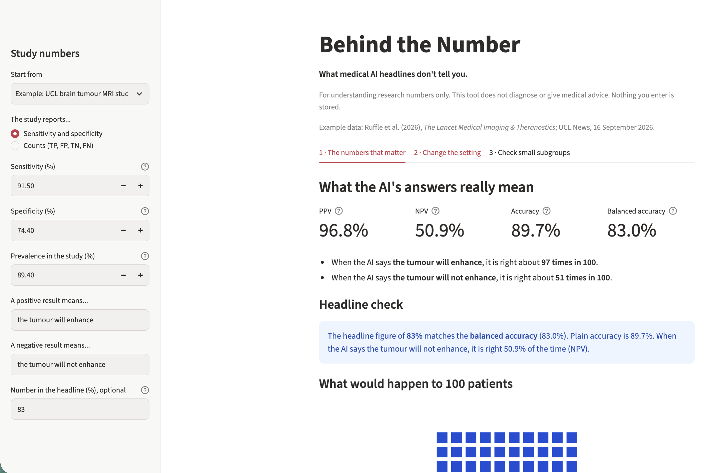

# Behind the Number
**What medical AI headlines don't tell you.**

**Live demo:** [behind-the-number.streamlit.app](https://behind-the-number.streamlit.app/) · **Video:** [YouTube](VIDEO_LINK)

Behind the Number is a web tool that helps non-experts understand the numbers in medical AI studies.



## The problem
In September 2026, news outlets reported that an AI could predict brain tumour
enhancement on MRI correctly "83% of the time". But 83% was the balanced accuracy,
not the share of correct predictions. And when the AI said a tumour would not
enhance, it was right only about half the time (NPV 0.51).

Readers rarely get the numbers they need to judge a medical AI: which measure a
headline figure is, how much to trust the AI when it says "no problem", and how
uncertain the results are for small groups such as children.

## Features
- **Find the numbers that matter:** calculate PPV, NPV, accuracy and balanced
  accuracy from sensitivity, specificity and prevalence (or from TP, FP, TN, FN
  counts), with plain-language sentences and a 100-patient picture.
- **Headline check:** enter the number from a news story and see which measure
  it matches.
- **Change the setting:** use a prevalence slider to see how PPV and NPV shift
  in a different patient group.
- **Check small subgroups:** get 95% confidence intervals and a warning when a
  subgroup is too small to trust.

## Example: an AI for brain tumour MRI
| | Reported | What Behind the Number shows |
|---|---|---|
| Headline figure | "83% correct" | Balanced accuracy, not accuracy (accuracy is 89.7%) |
| AI says "will not enhance" | not reported in the news | Right about 51 times in 100 (NPV) |
| Same AI where 30% of tumours enhance | not reported | NPV 95.3%, but PPV falls to 60.5% |
| Children (9 of 20) | "less accurate" | 95% CI: 26%–66%, too small to trust |

## How it works
With sensitivity $Se$, specificity $Sp$ and prevalence $p$:

$$PPV = \frac{Se \cdot p}{Se \cdot p + (1-Sp)(1-p)} \qquad NPV = \frac{Sp(1-p)}{Sp(1-p) + (1-Se)p}$$

$$\text{Accuracy} = Se \cdot p + Sp(1-p) \qquad \text{Balanced accuracy} = \frac{Se + Sp}{2}$$

- Subgroup confidence intervals use the **Wilson score method** (Wilson, 1927),
  which works better than the simple formula for small samples.
- **Assumption:** in the "Change the setting" tab, sensitivity and specificity
  are assumed to stay the same in the new setting. The app states this on screen.
- **Tested:** `test_metrics.py` checks every calculation against the figures
  published in the study (balanced accuracy 83.0%, NPV 0.51, NPV about 0.95 at
  30% prevalence) and against hand-calculated confidence intervals.

## Built with
Python · Streamlit · Plotly · Streamlit Community Cloud

AI-assisted coding was used during development.

## Run locally
```bash
git clone https://github.com/RowanCCccc/behind-the-number.git
cd behind-the-number
python3 -m pip install -r requirements.txt
python3 test_metrics.py
python3 -m streamlit run app.py
```

| File | What it does |
|---|---|
| `app.py` | The Streamlit interface |
| `metrics.py` | All calculations (no Streamlit needed) |
| `test_metrics.py` | Checks the calculations against published figures |

## Limitations
- This tool is for understanding research numbers only. It does not diagnose
  or give medical advice.
- Results depend on the numbers a study reports. If a study reports only AUC,
  PPV and NPV cannot be calculated.
- The prevalence slider assumes the AI performs the same in a new setting. In
  real life, performance can change with different patients, scanners or hospitals.
- No user input is stored.

## Roadmap
- Paste a news article or abstract and extract the numbers automatically
- Add more case studies, such as breast cancer screening
- Export a one-page summary report

## References
- Ruffle, J. et al. (2026) *The Lancet Medical Imaging & Theranostics*.
  [Article](https://www.thelancet.com/journals/lanmit/article/PIIS3117-4523(26)00012-2/fulltext)
- UCL News (2026) AI tool may help avoid MRI dye injections for brain tumour patients.
  [Press release](https://www.ucl.ac.uk/news/2026/sep/ai-tool-may-help-avoid-mri-dye-injections-brain-tumour-patients)
- Wilson, E.B. (1927) Probable inference, the law of succession, and statistical
  inference. *Journal of the American Statistical Association*, 22(158), pp. 209–212.

## About
Built by Rowan (Liujun) Chen, MSc Health Informatics with Data Science,
University of Leeds, for DSH Hacks V2 (November 2026). [LinkedIn](LINKEDIN_LINK)

## License
MIT
